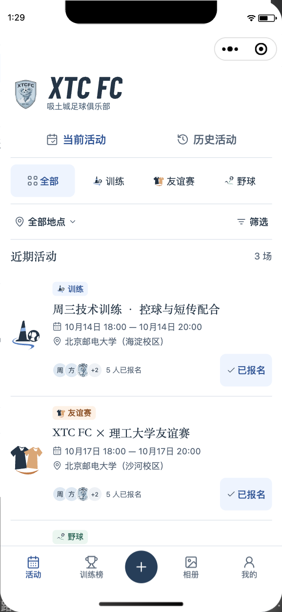
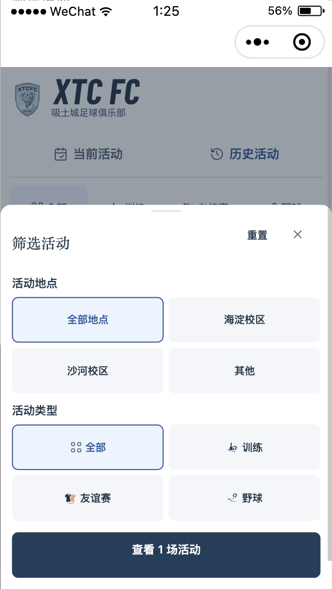
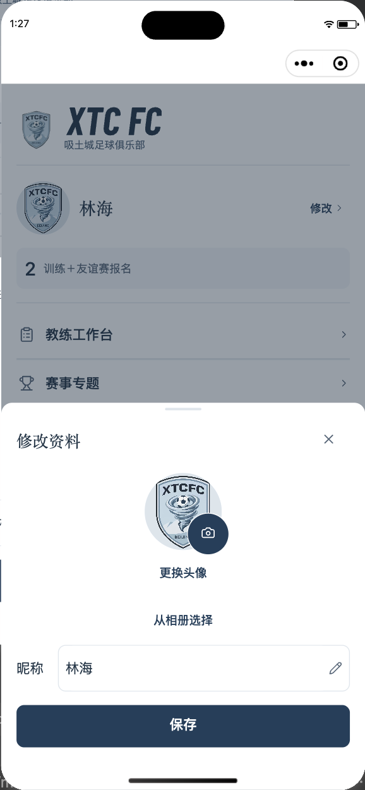

# 小程序全局视觉验收 · 2026-10-12

## 交付范围

现有 `app.json` 注册 14 个页面，另验证同页「发起野球」模式。全局白色／深蓝、宋体标题加载、矢量字标、分类图文标签、双色活动符号和 Lucide 功能图标已实现；保留原队徽、报名规则、真实头像／照片加载路径和战术板。取消装饰性照片与旧资源，无新增时间筛选。工作区已有业务改动未重置，此前视觉实现阶段未提交、上传或发布；后续开发版与字体交付见下方发布续记。

## 自动化与 API

| 检查 | 结果 |
| --- | --- |
| `node --test scripts/miniprogram/*.test.cjs` | 33 / 33 通过 |
| `GOCACHE="$PWD/.gocache" GOMODCACHE="$PWD/.gomodcache" go test ./...` | 全部通过 |
| `npm --prefix web run test` | 25 / 25 通过 |
| `npm --prefix web run build` | 通过 |
| `./scripts/validate_api_smoke.sh` | 隔离 API smoke 通过 |
| `git diff --check` | 通过 |
| 小程序静态资源引用 | 无缺失，包内资源约 124 KiB，字体不进入小程序包 |

新增测试覆盖分类语义、32 种类型／地点／当前历史组合、排序和取消、报名状态、三个头像／额外人数、头像失败首字、缺失人数、筛选切换后的头像重试、过期活动／预览请求、空数据、字体失败和弹层导航恢复。字体 Go 测试验证精确 WOFF 路径的 MIME／CORS，API、首页和许可证路径未扩大跨域权限。

本地字体 GET/HEAD 返回 200、`font/woff`、`Access-Control-Allow-Origin: *`，长度 3,968,644 bytes；字体包含 7546 个映射字符，内部名 AnyPitch Serif，Medium，附 OFL 许可证。子集保留 GB2312 与源码文案，未仅裁取样例活动名。

## 微信开发者工具

使用 Stable 2.02.2608070、基础库 3.17.3、官方 `miniprogram-automator`。在实际模拟器选择 iPhone 5（320px）、iPhone 12/13 Pro（390px）、iPhone 14 Pro Max（430px），通过 `systemInfo.windowWidth` 确认宽度，结束后恢复 390px。

数据来自独立 `/tmp/anypitch-visual-qa.db` 与本地 29178 端口服务，未写生产数据。为保留合法域名校验，自动化在内存中将请求桥接至隔离 API；结束后恢复原请求方法和会话。头像下载使用本地队徽作为测试图片，仅验证图片／首字呈现，截图不是生产球队资料。真实私有图片下载鉴权与审核另由自动化/API 测试覆盖。

| 页面／状态 | 实际渲染证据 |
| --- | --- |
| 活动、当前／历史、类型／地点、空组合、长标题、筛选弹层 | `events-*`、`history-*`、`filter-*`，320 / 390 / 430 |
| 活动详情、四状态报名与名单 | `detail-*`，320 / 390 / 430 |
| 个人、资料弹层 | `mine-390`、`profile-edit-*`，320 / 390 / 430 |
| 活动编辑、发起野球 | `coach-event-*`、`pickup-*`，320 / 390 / 430 |
| 登录与失败反馈 | `login-390` |
| 训练榜 | `stats-390` |
| 相册无封面、照片页空状态 | `albums-*`、`photos-390` |
| 教练入口、成员管理、战术板 | `coach-390`、`members-390`、`tactics-390` |
| 专题、专题管理、设置 | `topics-390`、`coach-topic-390`、`settings-390` |

最终巡检与宽度检查未记录 JavaScript exception。320px 下筛选已改为稳定双列；筛选和资料弹层隐藏底部导航，确认按钮可见。长活动标题换行，头像失败保留首字，未加载或失败的报名人数不显示虚假零值。

通过小程序详情提交报名后，隔离 API 复查返回 `available`；创建相册及打开照片页成功。现有内容检测规则仍生效：隔离环境没有微信内容检测配置，战术板名字保存返回「内容检测暂不可用」，没有跳过检测或假报成功。微信登录成功、昵称保存、教练活动文字编辑、图片上传审核和小程序战术板保存的完整真实成功链路 **未验证**；其成功／失败分支由现有 Go 和小程序自动化测试验证。截图中的宋体目前为可读回退，不能作为思源宋体实际加载证明。

## Web 浏览器回归

实际浏览器访问隔离服务，完成教练密码登录、桌面活动／日程／报名名单、手机活动切换、桌面与手机成员页面和战术板入口。Web 教练保存战术板后显示已保存名称；手机端可从菜单打开同一战术板。截图为 `web-desktop.jpg`、`web-mobile.jpg`、`web-members-mobile.jpg`、`web-tactics.jpg`、`web-tactics-mobile.jpg`。Web 使用既有主题，本次没有重做 Web 页面。浏览器临时视口已恢复。

## 未验证与发布状态

- 自有 HTTPS 字体地址尚未部署，本次仅完成静态资源、加载代码、许可证与服务路由；线上字体实际下载与首次加载性能 **未验证**。开发者工具对 HTTP／data URI 的试载失败，不视为 HTTPS 已通过。
- iOS、Android 真机宋体、SVG 和安全区 **未验证**，模拟器不等同真实设备。
- 上述需要微信内容检测配置的真实写入成功链路 **未验证**；未绕过原有规则。
- 未上传体验版，未提交审核，未发布小程序，未部署 Web／字体。

## 关键截图

## 发布续记

用户追加发布指令后，0.2.17 已通过官方 CLI 上传为开发版（273,808 bytes），字体已部署到自有 HTTPS，Web 字体渲染与微信开发者工具冷启动全局加载均通过。初始化改在页面 onReady，以避免入口跳转中断加载；小程序测试增至 33 项全部通过。上述「字体未部署／未实际加载」为实现阶段记录，已被本次验证更新；真机验证与正式发布仍未完成。微信后台页面被浏览器工具安全策略阻止访问，未代操作审核或发布。详情见 `docs/deployment-2026-10-12.md`。
